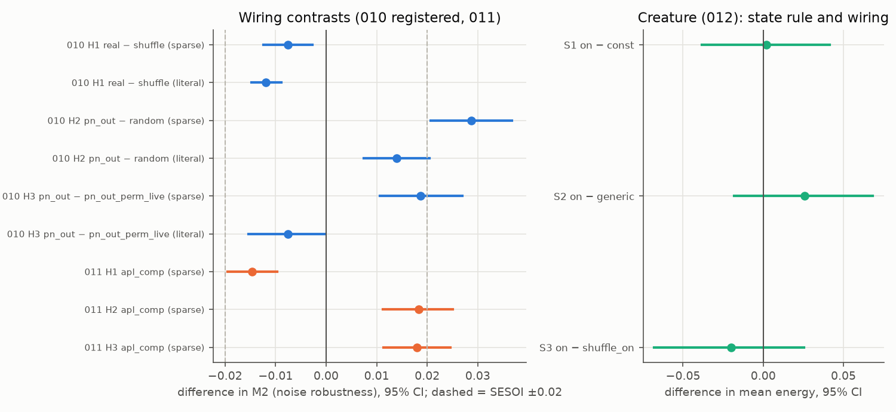

# NeuralPet

A digital "pet" whose learning circuit is the mushroom body of the adult *Drosophila* connectome
(FlyWire FAFB v783; hemibrain as a second fly), inside a worm-like body and world that we designed. A
research question first, then a pet you can raise in a phone browser. CPU only (MacBook Pro M4).

**It is not alive, not conscious and not a faithful emulation of a fly.** Every link between layers is
a designed rule, written down in `docs/ADAPTERS.md` before the runs that used it.



## What we found (full report: [reports/FINAL.md](reports/FINAL.md))

- **Real mushroom-body partners did not help dopamine-gated learning.** Against a degree-preserving
  shuffle they were slightly worse (registered, 3 connectome samples × 2 odour datasets, 64 seeds;
  effect smaller than the threshold we set for "matters").
- **Degree structure did help:** keeping each projection neuron's real out-degree beat random wiring in
  every sample and odour set. The real neuron ↔ out-degree pairing helped with a sparse Kenyon-cell code
  only.
- These wiring results held with graded APL feedback and compartment-specific dopamine.
- **In the creature, the homeostatic dopamine rule and the real wiring made no detectable difference**
  to survival or energy (wide CIs). Under the registered constants the learned preferences barely steer
  the body; we found this post hoc and report it as a design miss.
- Pets with the same genome and different histories became distinct, history-specific individuals.

Exploratory steps, deviations and null results are all in the report.

## Run it

```bash
uv sync
uv run python scripts/fetch_flywire.py        # FlyWire v783 into gitignored data/ (CC BY-NC 4.0)
uv run python scripts/extract_mb.py --side right && uv run python scripts/extract_mb.py --side left
uv run python scripts/fetch_door.py            # DoOR 2.0 + Hallem & Carlson tables
uv run python scripts/fetch_hemibrain.py && uv run python scripts/extract_hemibrain.py
uv run python experiments/010/run.py           # one command per experiment (001–012)
uv run python scripts/make_final_report.py     # reports/FINAL.md + reports/figures/
```

- **Play with a pet:** `scripts/run_play.sh`, then open the printed `http://127.0.0.1:8798/?t=…` link
  once. Feed it, offer smells, praise or scold it ([docs/PLAY.md](docs/PLAY.md)).
- **Research viewer (read-only):** `scripts/run_viewer.sh` (127.0.0.1:8797).
- Both bind to localhost only. To reach them from a phone, use a tunnel **with Cloudflare Access**
  (`docs/TUNNEL.md`).
- Clean reproduction from a fresh clone: [docs/REPRODUCTION.md](docs/REPRODUCTION.md).

## Data, licences, citations

Code: MIT (`LICENSE`, `CITATION.cff`). No connectome data are in this repository; scripts download them.
FlyWire is CC BY-NC 4.0, hemibrain CC BY 4.0, DoOR CC BY-SA 4.0. Cite Dorkenwald et al. 2024 and
Schlegel et al. 2024 (Nature 634), Zheng et al. 2018 (Cell 174), Scheffer et al. 2020 (eLife 9),
Münch & Galizia 2016 (Sci Rep 6) and Hallem & Carlson 2006 (Cell 125). Full list: [docs/DATA.md](docs/DATA.md).
