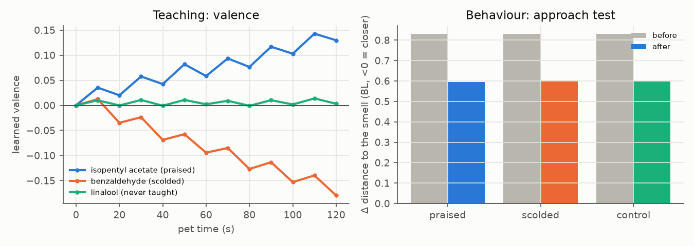

# Playing with the pet (WP6)

A separate play app on top of the frozen research code (tag `research-freeze`). You raise one pet: feed
it, let it rest, offer it smells, praise or scold it, and over time it learns which smells to approach
or avoid. It is a bio-inspired simulation, not a living thing (see the About page).

## Run
```sh
scripts/run_play.sh                 # http://127.0.0.1:8798/?t=<token>  (printed once at start)
NEURALPET_PLAY=0 scripts/run_play.sh   # read-only emergency mode: the page works, every action is refused
```
The token is `NEURALPET_PLAY_TOKEN` in the gitignored `.env` (created on first start; separate from the
viewer's token). Open the link once on each device: the token is exchanged for a session cookie and
removed from the address bar. To survive reboots, fill in and load
`scripts/ai.neuralpet.play.plist.template` (not installed by us). To reach it from a phone you need a
tunnel; **put Cloudflare Access in front before relying on the token alone** (docs/TUNNEL.md).

## Actions (fixed whitelist)
| action | what happens in the model |
|---|---|
| Feed | a food pellet appears just in front of the head; eating it raises energy and gives reward dopamine by the homeostatic rule (more when hungrier). Feeding also wakes a pet in torpor. |
| Offer smell | a whiff of the chosen DoOR odorant appears 0.6 body lengths ahead for 8 s (`offer_s`); a new whiff replaces the previous one, so praise or scold applies to the smell you just offered |
| Praise / Scold | a reward (0.8) / punishment (1.0) dopamine pulse on the Kenyon cells active **right now**, so it teaches whatever the pet smells at that moment |
| Drop food / toy (tap the arena) | a pellet (eaten once) or a toy that smells of the chosen odorant for 10 min |
| Lights off / on | rest: the CPG stops, only baseline energy is used |
| Rename (tap the name) | ≤ 24 characters, shown as plain text everywhere |
| New pet | the current pet becomes a read-only memorial with its life summary |

**Teaching (the headline mechanic).** Offer a smell, then praise while the pet is still smelling it:
the KC→MBON weights of the active cells grow, its learned valence for that smell rises, and its
steering turns towards that smell. Scold instead and the valence falls; it turns away. The bars under
"Personality" are that valence.

**Play-only steering gain.** The play pet uses `steer_gain` = 100 (play/config.json) instead of the
registered research value `K_CONTRAST = 25`. With 25 the creature shows no measurable chemotaxis: in an
exploratory check (`experiments/explore/steer_check.py`, valence forced to ±0.3, a smell 1 BL away, 3
odorants × 16 runs of 90 s) liked, disliked and steering-off pets end up equally far from the smell; with
100 the liked smell is approached and the disliked one avoided (numbers in reports/FINAL.md), so taught preferences would never show in behaviour. The
gain was picked by looking at that approach check, i.e. it is tuned, which is allowed only here: it is
set inside the play process, never in research runs, and no research result uses it. The research
consequence (weak brain-driven steering under the registered constants) is reported in reports/FINAL.md.

## Recorded teaching run (`uv run python scripts/play_teach_demo.py`, seed 20261108)
Six rounds over 2 minutes of pet time: offer isopentyl acetate → praise, offer benzaldehyde → scold;
linalool is never taught. Raw numbers: `docs/play_teach.json`; chart: `docs/play_teach.png`.



<!-- teach-table -->
| smell | taught | valence after | Δ distance, 2.5 BL test before → after | Δ distance, 1 BL test before → after |
|---|---|---|---|---|
| isopentyl acetate | praised | +0.130 | +0.83 → +0.59 | +0.17 → +0.67 |
| benzaldehyde | scolded | -0.180 | +0.83 → +0.60 | +0.17 → +1.42 |
| linalool | never | +0.003 | +0.83 → +0.60 | +0.17 → +0.69 |

Δ distance = change in head distance to a toy of that smell (BL; negative = moved closer); 2.5 BL test: 40 s, 4 copies; 1 BL test: 90 s, 8 copies. "before" = the same pet before any teaching.
<!-- /teach-table -->

Reading: the valences move the right way within a minute. In behaviour, the **dislike shows** (the pet
moves away from the scolded smell more than from the untaught one in the 1 BL test) but the **like does
not** (the praised smell is not approached more than the untaught one). The 2.5 BL test, the first one
we ran, is too far from the source to show anything (plume σ = 0.8 BL). The second test was fixed after
seeing the first and before running it.

## Life
- Real time at `speed` (play/config.json). When you come back after being away, the pet fast-forwards
  the elapsed time, capped at `catch_up_cap_s` (default 20 min of pet time); the diary says how long
  you were away and how much was simulated.
- Gentle by default: after `torpor_after_s` (60 s) at zero energy the pet goes into torpor and stops
  moving; feeding wakes it. `hard_mode: true` turns on the research mortality rule (120 s at zero energy
  ends the life).
- Body physics constants are the research ones and never change with age or play.

## Files (all in gitignored `play_data/`)
- `pet.npz`: the whole pet in one file (version field, brain weights, body, internal state, random
  generator states, diary). Written to a temp file, fsynced, then atomically renamed. Saved every 30 s,
  after every action and on shutdown.
- `pet.npz.1`–`.3`: rolling backups; a corrupt main file falls back to the newest good backup.
- `memorials/*.json`: past pets (read-only summaries).
- `interactions.jsonl`: append-only log of your actions with a state snapshot. It is your data and is
  never committed. It may be exported as an *exploratory* development dataset; it never enters
  confirmatory results.
- Backup: copy `play_data/` while the app is stopped (or any time: every file is replaced atomically).

## Security model
The app has write endpoints and may be reachable through a quick tunnel with only a token, so:
- binds `127.0.0.1` only; we never touch Cloudflare;
- `Host` must be `127.0.0.1:<port>`, `localhost:<port>`, `*.trycloudflare.com` or a name listed in
  `NEURALPET_PLAY_HOSTS` (DNS-rebinding guard), else 421;
- sign-in: `?t=<token>` compared in constant time, exchanged for a random server-side session in an
  `HttpOnly; SameSite=Strict` cookie (`Secure` when the request came over HTTPS), then a redirect to `/`
  so the token leaves the address bar and history; token failures are rate limited (10/min, then 429
  for everyone for the rest of the window);
- every state change is `POST /api/action` with a JSON body ≤ 1 KB, `Content-Type: application/json`,
  a CSRF token tied to the session (`X-CSRF-Token`), an `Origin` equal to the request host, a per-session
  limit of 30 actions/min and a strict schema check against the whitelist above; no endpoint takes
  paths, shell input or free text except the length-capped name, which the page only ever inserts as
  text (`textContent`; there is no `innerHTML` in app.js, tested);
- headers: CSP `default-src 'none'; script-src 'self'; style-src 'self'; …; frame-ancestors 'none'` (no
  inline script), `nosniff`, `X-Frame-Options: DENY`, `Referrer-Policy: no-referrer`, no CORS headers,
  `Cache-Control: no-store` on everything, HSTS when behind HTTPS;
- `NEURALPET_PLAY=0` makes it read-only.
- Sessions are in memory: a restart signs everyone out (open the token link again).
Tests: `tests/test_play.py` (auth, cookie flags, token rate limit, Host/Origin/CSRF, method, malformed
and oversized input, action rate limit, read-only switch, every action end to end, exact save/load round
trip, crash while saving).
