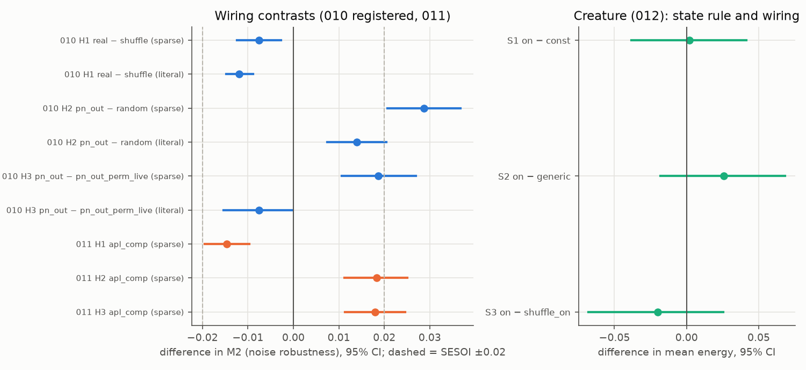
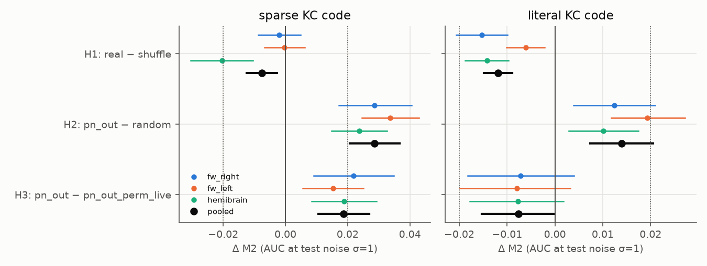
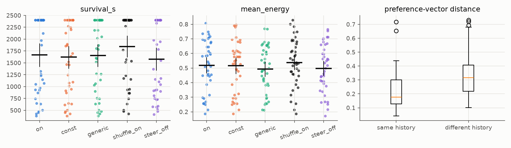
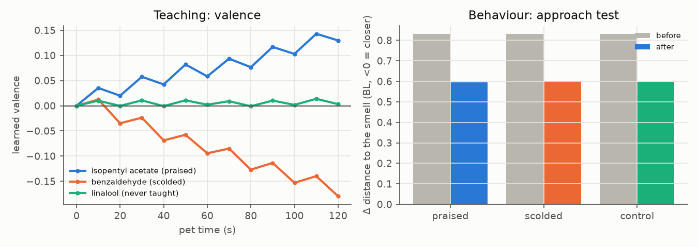

# NeuralPet — final report (v1.0)

*Generated by `scripts/make_final_report.py` from the result files; do not edit by hand.*

NeuralPet puts a sub-circuit of the adult *Drosophila* connectome (FlyWire FAFB v783 mushroom body,
plus the hemibrain as an independent fly) into a simple learning model, and that model into a designed
worm-like body in a designed world. It is a research toy and a pet you can raise in a browser. **It is
not alive, not conscious and not a faithful emulation of a fly.** Every link between layers (odours →
projection neurons, dopamine rules, readout, body, metabolism) is a rule we designed and wrote down in
`docs/ADAPTERS.md` before the runs that used it.

## Headline findings

1. **Real mushroom-body partners did not beat a degree-preserving shuffle; they were slightly worse.**
   Registered experiment 010 (64 seeds × 3 connectome samples × 2 odour sources): real − shuffle on
   noise robustness (M2) = -0.0076 [-0.0124, -0.0027] (d_z -0.38, Holm p 0.0067; replicated (smaller than SESOI)) with a sparse Kenyon-cell code, -0.0119 [-0.0148, -0.0089] (d_z -0.98, Holm p 3.6e-10; replicated (smaller than SESOI))
   with the literal (dense) code. Both are below the smallest effect we said would matter (±0.02). With
   the sparse code the deficit is carried mostly by one cell (hemibrain × door: -0.0405 [-0.0538, -0.0278]):
   4 of 6 sample × source cells have CIs that include 0,
   both FlyWire hemispheres are indistinguishable from 0,
   and at the harder (deviation) task setting it was -0.0007 [-0.0033, 0.0020].
2. **Real wiring did beat random wiring with the sparse code, by about the SESOI:** real − random
   +0.0202 [+0.0114, +0.0290] sparse, -0.0026 [-0.0093, +0.0043] literal (descriptive, not in the
   registered family). A degree-preserving shuffle did at least as well (shuffle − random
   +0.0278 [+0.0200, +0.0355] sparse, +0.0093 [+0.0029, +0.0157] literal), so the benefit comes from
   degree structure, not from which projection neuron contacts which Kenyon cell.
3. **Keeping each projection neuron's real out-degree helps.** pn_out − random = 0.0287 [0.0207, 0.0368] (d_z 0.86, Holm p 1.7e-08; replicated)
   sparse; 0.0139 [0.0074, 0.0205] (d_z 0.52, Holm p 0.00031; replicated (smaller than SESOI)) literal. It held (CI above 0) in every sample and both odour sources, in both code settings.
4. **The real pairing of a projection neuron with its out-degree helps with the sparse code only.**
   pn_out − pn_out_perm_live = 0.0187 [0.0106, 0.0269] (d_z 0.55, Holm p 0.00019; replicated (smaller than SESOI)) sparse; -0.0076 [-0.0153, -0.0002] (d_z -0.24, Holm p 0.057; not replicated: equivalent to 0 (90% CI within ±SESOI)) literal (the point
   estimate is negative; the exploratory 009 literal effect, +0.031 [+0.011, +0.052], did not replicate).
5. **The sparse-code wiring results held with graded APL feedback + compartment-specific dopamine**
   (experiment 011, sparse code only; 010 overturned: no). Caveats under the 011 table.
6. **In the creature, neither the homeostatic dopamine rule nor the real wiring made a detectable
   difference** to survival or mean energy (experiment 012, 40 seeds; smallest Holm p = 0.85).
   By the plan's own equivalence bounds the result is **inconclusive**, not null: the S1/S2 CIs are up to 2.2× (energy) and 3.3× (survival) wider than the ±0.02 / ±60 s equivalence bounds; the plan's rule for "the state rule matters" (S1 and S2 significant, same sign) is not met; nor is the rule for "real wiring helps the pet" (S3). And since
   learned valence barely reaches behaviour under the registered constants (next point), 012 could
   hardly have detected a state-rule effect.
7. **Brain-driven steering did not matter in the registered creature** (steering on − off, mean
   energy 0.020 [-0.031, 0.076]); a post-hoc check shows that under the registered steering gain the
   learned valence does not measurably steer the body (details below). We missed this before registering.
8. **Learned odour preferences (internal valences) diverged between individuals with the same genome and
   different histories, and re-adapted (slowly, incompletely) when food and toxic roles swapped.** Under
   the registered constants these internal differences do not show in behaviour.

## Expected versus what happened

| question | expectation | what happened |
|---|---|---|
| Does real MB wiring beat matched fake wiring? (CLAUDE.md, the one real question) | the project's starting hope: real > shuffle > random; the 010 plan, after 001–009, predicted real < shuffle | real < shuffle by a small margin (H1); real > random with the sparse code only; pn_out > random (H2) |
| Is the 001–009 pattern robust to a second fly, a second hemisphere and a second odour set? (010) | replicate or fail visibly | H1: sparse replicated, literal replicated; H2: sparse replicated, literal replicated; H3: sparse replicated, literal not replicated |
| What makes real worse than shuffle? (010 N2) | co-convergence of glomeruli or KC class structure | sparse: real − n2a (keeps co-convergence exactly) 0.0001 [-0.0020, 0.0022] and n2a − shuffle -0.0077 [-0.0122, -0.0033], so by the plan's rule co-convergence carries the deficit; literal: real − n2a -0.0034 [-0.0052, -0.0017], so there the pairing also matters. The co-convergence account holds for the pooled sparse code only |
| Does a more biological APL / dopamine change the answer? (011) | maybe | no, for the sparse code (see caveats) |
| Does the energy-dependent dopamine rule help the pet? (002, then 012) | yes, in a world where foraging is feasible | 002: null at the floor (pets starved 0.77 of the time). 012: inconclusive, now off the floor (0.525 [0.375, 0.675] of pets died) |
| Does the body–brain loop work? (012 sanity) | steering helps foraging | no detectable help; the registered gain is too weak to steer (exploratory) |
| Can one owner teach a pet a like and a dislike within minutes? (WP6) | yes | the learned valences move the right way within a minute; in behaviour the dislike shows, the like does not (play app only, play-only steering gain) |

## Methods in one page

- **Connectome samples.** FlyWire v783 right and left mushroom body, and the hemibrain v1.2 right MB
  (Scheffer et al. 2020) as an independent animal. PN→KC and KC→MBON synapse counts (≥ 5 synapses);
  details in `docs/MB_EXTRACTION.md`. No connectivity is committed; scripts download and derive it.
- **Odours.** DoOR 2.0 receptor responses mapped to glomeruli (60 odorants) and, as a second source,
  Hallem & Carlson 2006 (57 odorants not in the DoOR panel, from the DoOR.data tables).
- **Learning model.** Binary Kenyon cells with a k-winners-take-all "APL" (sparse: 10% active; literal:
  a fixed active fraction per sample measured once from the connectome input with random odours —
  fw_right 0.55, fw_left 0.57, hemibrain 0.61; cf. ~68% in CLAUDE.md and 5–10% in real flies), dopamine-gated depression of KC→MBON weights, ratio readout. Task:
  two odour sets, one rewarded; readout noise; metrics AULC, plateau, M2 (AUC at test noise σ = 1,
  primary), M3 (interference). Parameters chosen on synthetic circuits; one connectome smoke run (seed 7, outside the
  confirmatory range) was seen before the 010 plan was committed, as the plan states. Secondary metrics
  (AULC, plateau, M3 interference) for every contrast are in `reports/010/tables.md`.
- **Controls.** random (same edge count and weights), degree-preserving shuffle (curveball), pn_out
  (keeps PN out-degree), pn_out_perm_live (permutes out-degrees among PNs with odour input), N2a (keeps
  glomerular co-convergence exactly), N2b (shuffle within KC class). Verified by computed statistics
  (`reports/010/nulls.md`, `docs/NULLS.md`).
- **Statistics.** Paired across seeds, 95% bootstrap CIs, d_z, Holm across each confirmatory family,
  SESOI 0.02 for M2, equivalence by the 90% CI.
- **Creature (012).** The MB model drives a 12-segment overdamped body with anisotropic drag and a
  phase-oscillator CPG on a 6 × 6 body-length torus. The brain only biases the CPG (steering from two
  head sensors × learned valence; amplitude/frequency from energy). Metabolism drains energy with muscle
  effort. Reward dopamine follows drive reduction (Keramati & Gutkin 2014). All constants were fixed on
  synthetic wiring with reward modulation off (pilot rounds 1–7) and asserted in code before the run.

### The creature: real data versus our design

| part | real data | our design |
|---|---|---|
| Body plan: 12 rigid segments (13 nodes), 1 body length (BL) long, head = node 0 | — | all of it; segment count configurable (`Body(n_seg=…)`) |
| Joints: torsional spring (K = 1) + damper (0.002) | — | all of it |
| Muscles: one dorsal/ventral torque pair per joint, torque = 0.4·(amp·sin φ_j + steer) | — | all of it |
| Medium: anisotropic viscous drag, normal / tangential = 10 (resistive-force theory, overdamped) | the physical principle (low-Reynolds undulatory locomotion) is textbook physics | the constants |
| Locomotor CPG: 11 coupled phase oscillators, one wave per body, head → tail | — | all of it (no connectome motor circuit is used) |
| Head sensors: two points 0.04 BL left/right of the head, 0.02 BL ahead | — | positions |
| Odour → glomeruli at each sensor | DoOR 2.0 receptor responses (Münch & Galizia 2016) mapped to glomeruli | Gaussian plumes (σ = 0.8 BL), mixing rule, noise, scaling (adapters v4, v8) |
| Brain: PN → KC → MBON | FlyWire v783 right mushroom body wiring (or hemibrain for checks) | binary kWTA KCs (10%), single global dopamine, plasticity rule (v1/v2) |
| Brain → body | — | steering = 0.35·tanh(25·valence·sensor contrast); state → CPG amplitude/frequency; innate avoidance reflex after a toxic hit |
| World | — | a 6 × 6 BL torus (no walls: undulating bodies got pinned to walls 79% of the time in the pilot), 4 food and 2 toxic sources |
| Internal state: energy, curiosity | — | all rules; reward dopamine = drive reduction after Keramati & Gutkin 2014 (a model, not data) |
| Metabolism: drain = baseline + effort·(mean squared muscle activation) | — | constants |
| Brain shape drawn in the head | FlyWire neuron positions and sampled synapse points (`data/mb/shapes.npz`) | scale and placement in the head (a display choice, labelled in the UI) |
| Body surface drawn as a tube | — | built every frame from the simulated centerline |
| Skin pattern | — | cosmetic readout of learned odour preferences and age, labelled cosmetic |

## Experiment 010 (confirmatory): does the wiring result replicate?

Plan: `experiments/010/PLAN.md` (committed before the run). 64 seeds,
3 samples, 2 odour sources, 5376 runs. Runs at the task ceiling
(plateau ≥ 0.99): 404.

| hyp | contrast | sparsity | mean diff [95% CI] | 90% CI | d_z | p | p Holm | verdict |
|---|---|---|---|---|---|---|---|---|
| H1 | real − shuffle | sparse | -0.0076 [-0.0124, -0.0027] | [-0.0116, -0.0034] | -0.38 | 0.0034 | 0.0067 | replicated (smaller than SESOI) |
| H1 | real − shuffle | literal | -0.0119 [-0.0148, -0.0089] | [-0.0144, -0.0094] | -0.98 | 6e-11 | 3.6e-10 | replicated (smaller than SESOI) |
| H2 | pn_out − random | sparse | 0.0287 [0.0207, 0.0368] | [0.0220, 0.0354] | 0.86 | 3.4e-09 | 1.7e-08 | replicated |
| H2 | pn_out − random | literal | 0.0139 [0.0074, 0.0205] | [0.0085, 0.0195] | 0.52 | 0.0001 | 0.00031 | replicated (smaller than SESOI) |
| H3 | pn_out − pn_out_perm_live | sparse | 0.0187 [0.0106, 0.0269] | [0.0118, 0.0256] | 0.55 | 4.8e-05 | 0.00019 | replicated (smaller than SESOI) |
| H3 | pn_out − pn_out_perm_live | literal | -0.0076 [-0.0153, -0.0002] | [-0.0140, -0.0014] | -0.24 | 0.057 | 0.057 | not replicated: equivalent to 0 (90% CI within ±SESOI) |

Per sample and odour source:

| hyp | sparsity | fw_right | fw_left | hemibrain | door | hallem |
|---|---|---|---|---|---|---|
| H1 | sparse | -0.0021 [-0.0087, 0.0048] | -0.0003 [-0.0067, 0.0062] | -0.0204 [-0.0305, -0.0104] | -0.0162 [-0.0228, -0.0097] | 0.0010 [-0.0047, 0.0070] |
| H1 | literal | -0.0153 [-0.0206, -0.0099] | -0.0061 [-0.0102, -0.0022] | -0.0142 [-0.0188, -0.0097] | -0.0180 [-0.0227, -0.0134] | -0.0057 [-0.0090, -0.0024] |
| H2 | sparse | 0.0287 [0.0172, 0.0405] | 0.0336 [0.0246, 0.0430] | 0.0237 [0.0147, 0.0327] | 0.0224 [0.0117, 0.0332] | 0.0350 [0.0208, 0.0499] |
| H2 | literal | 0.0124 [0.0039, 0.0209] | 0.0193 [0.0118, 0.0272] | 0.0101 [0.0029, 0.0174] | 0.0187 [0.0079, 0.0293] | 0.0092 [0.0007, 0.0176] |
| H3 | sparse | 0.0220 [0.0091, 0.0348] | 0.0153 [0.0056, 0.0251] | 0.0189 [0.0085, 0.0292] | 0.0151 [0.0030, 0.0274] | 0.0223 [0.0101, 0.0352] |
| H3 | literal | -0.0071 [-0.0183, 0.0040] | -0.0080 [-0.0199, 0.0032] | -0.0077 [-0.0178, 0.0018] | -0.0077 [-0.0212, 0.0050] | -0.0075 [-0.0163, 0.0015] |

Null-model contrasts (pre-specified, not in the family):

| contrast | sparsity | M2 | AULC | M2 fw_right | M2 fw_left | M2 hemibrain |
|---|---|---|---|---|---|---|
| N2-pairing: real − n2a_coconv | sparse | 0.0001 [-0.0020, 0.0022] | -0.0001 [-0.0022, 0.0019] | 0.0031 [-0.0015, 0.0078] | 0.0032 [-0.0001, 0.0067] | -0.0061 [-0.0078, -0.0044] |
| N2-pairing: real − n2a_coconv | literal | -0.0034 [-0.0052, -0.0017] | -0.0046 [-0.0058, -0.0033] | -0.0029 [-0.0064, 0.0004] | 0.0006 [-0.0019, 0.0029] | -0.0078 [-0.0099, -0.0057] |
| N2-coconv: n2a_coconv − shuffle | sparse | -0.0077 [-0.0122, -0.0033] | -0.0115 [-0.0155, -0.0073] | -0.0052 [-0.0106, 0.0003] | -0.0036 [-0.0092, 0.0019] | -0.0143 [-0.0244, -0.0042] |
| N2-coconv: n2a_coconv − shuffle | literal | -0.0085 [-0.0112, -0.0058] | -0.0115 [-0.0145, -0.0087] | -0.0123 [-0.0173, -0.0077] | -0.0066 [-0.0107, -0.0027] | -0.0065 [-0.0105, -0.0024] |
| N2-class: n2b_subtype − shuffle | sparse | 0.0027 [-0.0006, 0.0061] | -0.0055 [-0.0090, -0.0018] | 0.0064 [-0.0000, 0.0131] | 0.0065 [0.0017, 0.0117] | -0.0049 [-0.0114, 0.0015] |
| N2-class: n2b_subtype − shuffle | literal | -0.0022 [-0.0050, 0.0007] | -0.0042 [-0.0079, -0.0005] | -0.0035 [-0.0081, 0.0010] | 0.0003 [-0.0038, 0.0044] | -0.0032 [-0.0071, 0.0006] |
| real − n2b_subtype | sparse | -0.0102 [-0.0150, -0.0055] | -0.0061 [-0.0099, -0.0021] | -0.0084 [-0.0149, -0.0021] | -0.0068 [-0.0125, -0.0008] | -0.0155 [-0.0237, -0.0073] |
| real − n2b_subtype | literal | -0.0097 [-0.0129, -0.0065] | -0.0119 [-0.0149, -0.0089] | -0.0118 [-0.0169, -0.0067] | -0.0063 [-0.0108, -0.0020] | -0.0110 [-0.0153, -0.0068] |

**Protocol deviation.** The first 010 and 011 runs used unregistered, harder task parameters because the
code default was never updated after the pilot (`experiments/010/DEVIATION.md`). Those raw outputs are
kept; the registered rerun above is the confirmatory result. At the harder setting all effects were
smaller (H1 sparse -0.0007 [-0.0033, 0.0020], H2 sparse 0.0083 [0.0045, 0.0121], H3 sparse
0.0068 [0.0022, 0.0113]; `reports/010/deviation/tables.md`). A constants assert now guards 012.

## Experiment 011: a more biological APL and dopamine

| hyp | 010 (kwta, global) | apl_comp | apl_global | kwta_comp | apl_comp: sign holds | size holds | overturns 010 |
|---|---|---|---|---|---|---|---|
| H1: real − shuffle | -0.0076 [-0.0124, -0.0027] | -0.0146 [-0.0195, -0.0097] | -0.0145 [-0.0192, -0.0098] | -0.0091 [-0.0134, -0.0047] | yes | yes | no |
| H2: pn_out − random | 0.0287 [0.0207, 0.0368] | 0.0183 [0.0112, 0.0251] | 0.0195 [0.0124, 0.0262] | 0.0253 [0.0179, 0.0326] | yes | yes | no |
| H3: pn_out − pn_out_perm_live | 0.0187 [0.0106, 0.0269] | 0.0180 [0.0113, 0.0246] | 0.0193 [0.0125, 0.0259] | 0.0217 [0.0136, 0.0301] | yes | yes | no |

**010 conclusion overturned by apl_comp: no.**

Caveats (from the audit, reviews/final.md): 011 used the sparse code only, so it says nothing about the
literal results. Its H1 "sign holds" rule is an equivalence test written when the 010 run it checked
was the deviation run (H1 ≈ 0); with the registered H1 negative, "yes" there means "within ±0.02", not
"negative". The graded APL does not equalise KC activity across wirings (apl_comp KC mean rate:
random 0.0674, pn_out 0.0754, pn_out_perm_live 0.0774), so H2/H3 there
are partly confounded with activity level. The secondary AULC for H2 under apl_comp is
-0.0051 [-0.0156, 0.0051].

## Experiment 012: the creature

| cond | survival s | died | mean energy | frac time E>0 | meals | toxic hits | valence gap food−toxic |
|---|---|---|---|---|---|---|---|
| on | 1666.000 [1420.750, 1905.227] | 0.525 [0.375, 0.675] | 0.518 [0.465, 0.571] | 0.902 [0.870, 0.932] | 11.050 [8.575, 13.525] | 4.725 [3.950, 5.525] | 0.063 [0.049, 0.078] |
| const | 1619.515 [1382.934, 1844.881] | 0.675 [0.525, 0.825] | 0.516 [0.462, 0.569] | 0.897 [0.866, 0.926] | 10.525 [8.125, 12.900] | 4.250 [3.500, 5.025] | 0.064 [0.048, 0.082] |
| generic | 1658.380 [1421.589, 1884.106] | 0.625 [0.475, 0.775] | 0.492 [0.443, 0.542] | 0.901 [0.870, 0.929] | 10.575 [8.300, 12.825] | 5.075 [4.175, 6.050] | 0.057 [0.042, 0.075] |
| shuffle_on | 1845.485 [1620.398, 2061.237] | 0.450 [0.300, 0.600] | 0.538 [0.488, 0.587] | 0.926 [0.900, 0.951] | 13.475 [11.025, 15.876] | 5.700 [4.775, 6.625] | 0.077 [0.063, 0.091] |
| steer_off | 1579.485 [1345.944, 1812.673] | 0.625 [0.475, 0.775] | 0.498 [0.448, 0.546] | 0.894 [0.864, 0.921] | 10.050 [7.700, 12.375] | 5.325 [4.400, 6.250] | 0.069 [0.054, 0.084] |

| test | contrast | metric | mean diff [95% CI] | d_z | p | p Holm |
|---|---|---|---|---|---|---|
| S1 | on − const | survival_s | 46.4850 [-146.6855, 244.9336] | 0.07 | 0.65 | 1 |
| S1 | on − const | mean_energy | 0.0018 [-0.0381, 0.0416] | 0.01 | 0.93 | 1 |
| S2 | on − generic | survival_s | 7.6200 [-151.4017, 166.1544] | 0.01 | 0.93 | 1 |
| S2 | on − generic | mean_energy | 0.0259 [-0.0180, 0.0684] | 0.18 | 0.26 | 1 |
| S3 | on − shuffle_on | survival_s | -179.4850 [-416.2800, 44.8806] | -0.24 | 0.14 | 0.85 |
| S3 | on − shuffle_on | mean_energy | -0.0199 [-0.0681, 0.0253] | -0.13 | 0.41 | 1 |

The S2 control was matched to the `on` run's mean reward dopamine **in expectation, not in
realisation**: its quadratic was rescaled at the `on` run's pre-meal energies, but the generic run
meets other energies and is clipped at 0. Of 36 seeds with meals, the generic rule gave exactly
zero reward dopamine in 9 and less than half of the `on` amount in 10 (median
ratio 0.92; the `const` control matched exactly, median ratio 1.000). So S2 is a
weaker rule-6 control than intended. This is the plan as registered; a better match would need a new plan.

Sanity check, not a headline (steering on − off):

| metric | on − steer_off |
|---|---|
| meals | 1.000 [-1.800, 3.975] |
| mean_energy | 0.020 [-0.031, 0.076] |
| survival_s | 86.515 [-183.401, 371.110] |
| valence_gap | -0.006 [-0.019, 0.007] |

Individuality (pre-specified secondary):

- 20 individuals with different histories; 20 extra individuals sharing 5 histories but with other noise streams.
- Mean pairwise distance of preference vectors: different histories 0.3271 [0.3081, 0.3468]; same history, other noise 0.2143 [0.1782, 0.2554].
- Correlation of an individual's preferences with its own history (food +1, toxic −1, absent 0): 0.708 [0.628, 0.775]; with other individuals' histories (seed-shuffled baseline): 0.018 [-0.027, 0.064]; difference 0.690 [0.593, 0.774].

The CIs above resample pairs of individuals, which are not independent. Resampling individuals (and
whole same-history groups) instead gives different histories [0.261, 0.393], same history
[0.153, 0.302], difference +0.113 [0.008, 0.207]: still above 0, but much less precise.
These are internal valences; the steering results below mean they barely reach behaviour.

Adaptation to a swap of food and toxic roles (pre-specified secondary):

Food and toxic sources swap roles halfway. Gap = valence(new food odours) − valence(new toxic odours).
- at the swap: -0.056 [-0.068, -0.044]; at the end: -0.002 [-0.023, 0.019]; change 0.053 [0.032, 0.077].
- no-swap control, same gap measured at the end: -0.096 [-0.114, -0.079].
- mean energy, swap vs no swap (paired): -0.073 [-0.123, -0.029].

**Exploratory (post hoc): why steering did not matter.** `experiments/explore/steer_check.py` forces the
learned valence to ±0.3 and places a smell 1 body length to the side (48 runs of 90 s per cell,
3 odorants). Change in distance to the smell (BL, negative = closer), 95% CI:

| steering gain | valence +0.3 | valence −0.3 | steering off |
|---|---|---|---|
| registered (K = 25) | +1.40 [+1.14, +1.67] | +1.35 [+1.12, +1.58] | +1.34 [+1.02, +1.65] |
| 4× (K = 100) | +0.50 [+0.25, +0.78] | +1.54 [+1.37, +1.69] | — |

Paired with steering off (same seed and odorant), the change in distance is: registered gain, valence
+0.3 +0.07 [-0.30, +0.43], −0.3 +0.01 [-0.19, +0.23]; 4× gain, +0.3 -0.84 [-1.24, -0.45],
−0.3 +0.20 [-0.09, +0.49]. So at 4× a positive valence reduces the drift away from the smell
(the creature still ends farther away than it started), while avoidance is not distinguishable from
steering off. A first version of the script used odour index 0, which is water (no receptor response);
it was discarded and the three odorants above were chosen by name before the rerun.

Under the registered gain the creature's learned preferences do not reach its behaviour, so 012 tested
the dopamine rule and the wiring mostly through what the creature bumps into, not through what it seeks.
The synthetic pilot had already shown no steering benefit (round 7), and we registered the constants
without following that up: a design miss on our side. A new pre-registered experiment
with the gain fixed by a chemotaxis criterion is the obvious next step (`docs/OPEN_QUESTIONS.md`).

## Operational life criteria

**When the criteria were set.** The 012 plan pre-specified "met" rules only for individual divergence and
adaptation. The self-maintenance and precariousness verdicts below were defined after the 012 results
(this page was first committed after them) and should be read as post hoc descriptions.

| criterion | operational test (experiment 012, PLAN.md) | verdict |
|---|---|---|
| **Self-maintenance**: keeps its internal variable away from the lethal bound by its own actions | fraction of life with energy > 0 and mean energy in a world where energy drains with effort; compared across state rules (S1, S2) | **met, but not specific (post hoc).** Pets keep energy above zero most of the time, yet the homeostatic dopamine rule did no detectably better than a constant rule or a generic substitute (S1, S2 inconclusive; the generic substitute was matched in expectation, not in realisation). What maintains energy here is the fixed body/world rules; no learning-off condition was run, so the role of learning is untested. |
| **Precariousness / mortality**: can die, and dying depends on what it does | deaths within 2400 s with mortality on; survival time | **met in the weak sense (post hoc).** About half or more of the pets die within the life, so survival is not at ceiling. Whether dying depends on the brain is open: no condition (state rule, wiring, steering off) changed survival detectably. |
| **Individual divergence**: one genome, different histories → different, history-specific learned preferences | preference vectors of 20 individuals with different histories vs individuals sharing a history but not noise; correlation with own history vs a seed-shuffled baseline | **met for internal valences (pre-specified rule).** Learned preferences track the individual's own history far above the shuffled baseline, and different histories give more different preference vectors than same history with different noise (still true, with much wider CIs, when individuals rather than pairs are resampled). These are internal valences: under the registered steering gain they barely reach behaviour, so behavioural individuality is not shown. |
| **Adaptation**: its learned preferences change when the world changes | food and toxic roles swap halfway; does the learned gap move towards the new roles? | **met for internal valences, partly (pre-specified rule).** The gap moves towards the new roles (CI of the change above 0) but only reaches about zero by the end of the life: re-learning is slow and incomplete. Not shown in behaviour, for the same reason as above. |
| Brain-driven behaviour (sanity, not a life criterion) | steering on vs off | **not met.** Steering off made no detectable difference to meals, energy or survival. Under the registered steering gain the learned valence hardly steers the body (see the OPEN_QUESTIONS entry of 2026-11-08). |
| Reproduction | — | **untested** (future work). |
| Evolution / heredity | — | **untested** (future work). |

## The play app

A separate app (`src/neuralpet_play/`, `play/`, docs/PLAY.md) lets one owner raise and teach a pet from
a phone. It imports the frozen research code (tag `research-freeze`, checked by `tests/test_freeze.py`)
and never feeds results. It uses a play-only steering gain (K = 100), chosen by looking at behaviour,
which is not allowed for research and is labelled as such. Recorded teaching run (seed 20261108, 2
minutes): learned valence isopentyl acetate (praised) +0.130, benzaldehyde
(scolded) -0.180, linalool (never taught) +0.003.
Approach test with the smell 1 BL away, change in distance before → after teaching: praised
+0.17 → +0.67, scolded +0.17 → +1.42,
control +0.17 → +0.69 BL (one pet, 8 copies; a demonstration, not a statistic).
A first test with the smell 2.5 BL away (outside most of the plume) showed no difference for any smell
(after teaching: +0.59, +0.60, +0.60 BL); the 1 BL test was chosen after
seeing it. Note the pattern differs from the forced-valence check above (there attraction showed and
avoidance did not); with one pet and 8 copies neither pattern is established.

## Earlier exploratory experiments (001–009)

These shaped the confirmatory plans; they are exploratory (one sample, one task setting each).
- 001: real − shuffle, trials to criterion +214 [+187, +241], M2 -0.160 [-0.188, -0.132] (pooled readout).
- 004: with a ratio readout the trials gap shrank to +27 [-3, +68]; M2 -0.032 [-0.041, -0.022].
- 006: DoOR odours, real − shuffle M2 -0.007 [-0.016, +0.002]; real − random +0.029 [+0.012, +0.046].
- 007: pn_out − random +0.025 [+0.010, +0.040] with DoOR odours but -0.033 [-0.046, -0.020] with random odours.
- 008/009: pn_out − pn_out_perm +0.052 [+0.035, +0.072]; within live PNs +0.022 [+0.004, +0.040] (sparse), +0.031 [+0.011, +0.052] (literal).
- 002: energy-dependent dopamine in the first pet, mean energy -0.006 [-0.018, +0.005]; the pet was starving 0.77 of the time.

## What is not supported

- That the real fly's specific PN→KC partners help learning: they did not beat a degree-preserving
  shuffle in any model we built. (Real did beat random wiring with the sparse code, but no more than the
  shuffle did.)
- That the pet's internal-state rule matters: not detected in 002 or 012, and 012 was underpowered for it.
- That the creature's brain controls its foraging: not under the registered constants.
- That individuals differ in behaviour: their learned valences differ; their behaviour was not shown to.
- Anything about experience, consciousness, or being alive. The "life criteria" above are behavioural
  tests of a simulation.
- Generality beyond our model: binary KCs, one task family, designed odour mapping, a designed body.
  Results could differ with spiking neurons, other plasticity rules or other tasks.
- Sample size of flies: three mushroom bodies from two animals.

## Reproduce

`docs/REPRODUCTION.md` (clean clone, data fetch, one command per experiment). Data licences and
citations: `docs/DATA.md`. Code licence: MIT.
